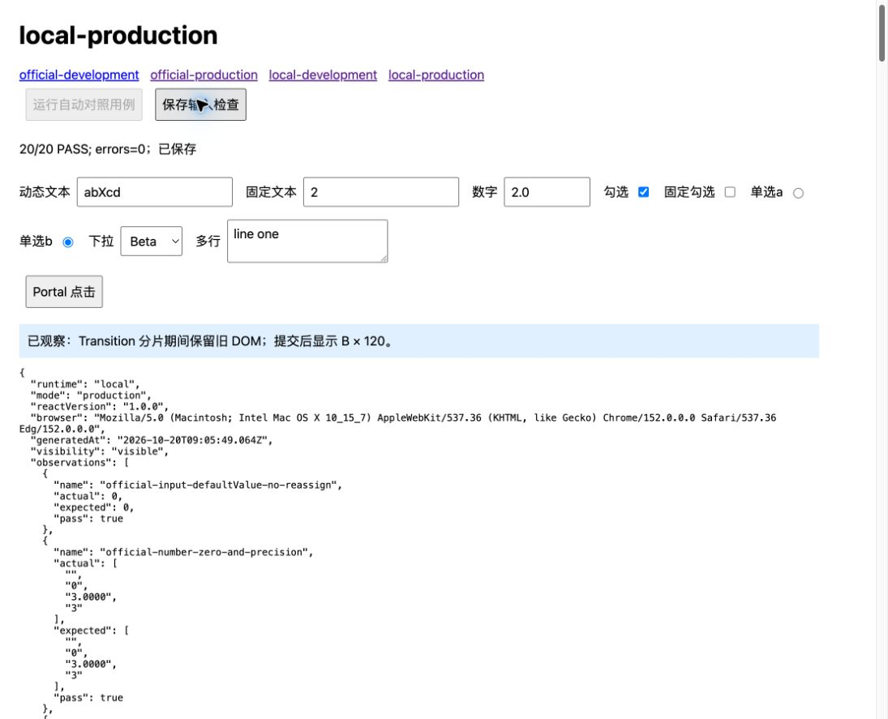

# React 18.3.1 浏览器补测与提交验收

日期：2026-10-20。工作目录：`/Users/wangcheng/Documents/workSpace/frontEnd/referenceProjects/repos/react/react-source`。分支：`codex/fix-react18-core-flows`。

本报告接续 [源码修复报告](repair-report.md)，执行用户认可的建议：补真实浏览器输入、关键调度与 Effect 场景，选取相关官方用例适配验证，完成后在当前分支提交。原 F01–F17 的修复及 216 项对照范围全部保留。

## 本次结果

浏览器为本机 **Microsoft Edge / Chromium 152**，四组均在可见标签页运行。同一份测试代码分别链接官方 18.3.1 发布包和本地构建产物，不使用 jsdom、Scheduler mock 或假时钟。

| 运行时            | 开发模式   | 生产模式   |
| ----------------- | ---------- | ---------- |
| 官方 React 18.3.1 | 20/20 通过 | 20/20 通过 |
| 本地实现          | 20/20 通过 | 20/20 通过 |

共 **80 项浏览器断言，40 项官方/本地比较**，结果一致，四次运行的页面 `error` / `unhandledrejection` 均为空。原始事件记录中的 `isTrusted` 均为 `true`。浏览器补测未发现需要继续修改运行时代码的新缺陷。

完整回归和提交前检查的最终结果见本报告下方“提交前复验”。此前修复阶段的 216 项结果保留在 `repair-20261020`，本次重新运行的结果另存于 `browser-20261020`。

## 基准和证据来源

- 当时的官方源码：`repos/react/react` 的 `codex/react-18.3.1`。2026-10-24 起同一提交在 `repos/react/react18`。下文源码链接已改到 `react18`。
- HEAD 和 `v18.3.1` 均为 `f1338f8080abd1386454a10bbf93d67bfe37ce85`；核验同时要求官方工作区干净。
- 发布包固定为 `react@18.3.1` / `react-dom@18.3.1`；它们实际依赖的 Scheduler 为 `0.23.2`。没有读取或引用 React 19。
- 官方生产 ReactDOM 的内部 `version` 为 `18.3.1-next-f1338f8080-20240426`，包版本仍为 18.3.1。本地 `React.version` 仍是项目自身的 `1.0.0`，不冒充官方发布包。
- 四份浏览器 bundle 由同一个 [harness.js](/Users/wangcheng/Documents/workSpace/frontEnd/referenceProjects/repos/react/react-source/scripts/tests/browser/harness.js) 生成。构建时检查 ReactDOM 的 peer React 与测试导入的是同一实例，并保存实际加载文件及 SHA-256。
- [comparison.json](browser-20261020/comparison.json) 包含逐项比较；[bundle-manifest.json](browser-20261020/bundle-manifest.json) 绑定测试脚本、包文件和浏览器 bundle。比较命令会核验指纹与当前磁盘内容一致。

## 真实输入检查：每组 11 项

所有输入均通过浏览器工具的按键、逐字输入或点击执行，不在页面脚本中调用 `dispatchEvent` 来替代操作。

| 检查                | 操作及断言                                                                           |
| ------------------- | ------------------------------------------------------------------------------------ |
| 动态受控文本与光标  | 输入 `abcd`，左移两次，输入 `X`；DOM 与 state 均为 `abXcd`，光标保留在位置 3         |
| 固定受控文本        | value 固定为数字 2，尝试输入 `2.0`；输入处理结束恢复为 `2`                           |
| number 聚焦输入     | value 为数值 2，输入 `2.0`；聚焦期间保留字符串 `2.0`，defaultValue 为 `2`            |
| number 失焦         | 在根事件处理后的 document focusout 监听中取样；defaultValue 同步为 `2.0`             |
| number 后续兄弟更新 | 其他字段引发父组件重渲染；当前 value 仍为 `2.0`，defaultValue 按 props 同步回 `2`    |
| checkbox            | 空格键勾选动态受控框，同时验证固定 false 框恢复为未选中                              |
| radio               | 点击同 name 分组中的 b；a 取消、b 选中，state 为 b                                   |
| select              | 聚焦后按 `b`，使用浏览器原生首字母选项定位选择 Beta；DOM 和 state 均为 b             |
| textarea            | 逐字输入 `line one`，DOM 与 state 一致                                               |
| Portal 冒泡         | 点击 Portal 内按钮，日志依次为子处理器、React 父处理器；两者均为可信原生 click       |
| 可信 change 覆盖    | 文本、固定文本、number、两种 checkbox、radio、select、textarea 均实际触发可信 change |

原生下拉的 ArrowDown/Enter 在此次工具与 macOS 控件组合下没有改变选项，改用已验证的原生首字母键 `b`；没有通过脚本赋值来制造通过结果。

## 自动浏览器检查：每组 9 项

| 检查                         | 断言                                                                                                     |
| ---------------------------- | -------------------------------------------------------------------------------------------------------- |
| defaultValue 不变            | 重渲染相同 input defaultValue，不调用其 setter                                                           |
| number 的 0 和字符串精度     | `"" → 0 → "3.0000" → "3"`，DOM 值依次准确对应                                                            |
| 多选 defaultValue            | 初次选 giraffe/gorilla，后来改 defaultValue 为 monkey，不覆盖当前选择                                    |
| flushSync / Layout / Passive | Layout 与 Passive 均读取已提交 DOM，并在 flushSync 返回前执行                                            |
| Layout 内更新                | 首次 Layout 更新到 1；返回时和下一次 rAF 取样均为 1，Effect 顺序与官方一致                               |
| DefaultLane 渲染             | render 返回时尚未提交；随后完成 DOM、Layout、Passive，最终取样一致                                       |
| Scheduler 优先级与取消       | 已取消任务不执行；两个 UserBlocking 任务先于两个 Normal 任务，FIFO 顺序正确                              |
| Scheduler continuation       | 工作达到 shouldYield 后返回 continuation；微任务先于 continuation 执行，证明经过宿主事件边界             |
| Transition 分片              | 120 个有界耗时组件更新；中途 rAF 观察到部分 render 已执行但 DOM 仍全部为 A，提交后全部为 B，没有混合 DOM |

这里验证的是浏览器事件循环、真实 DOM、Effect 顺序和 **rAF 渲染机会**。rAF 回调本身发生在绘制前，因此不把它等同于实际屏幕像素已呈现，也不声称“useEffect 总在 paint 后执行”。截图用于核验最终可见页面，不能证明每一帧的物理呈现时点。

## 官方用例的对应和适配

以下均来自固定的 v18.3.1 源码。运行的是适配后的同义行为检查，**没有声称运行了官方原始 Jest 套件**。

| 官方来源                                                                                                                                                                              | 采用内容                                       | 适配方式                                                                                        |
| ------------------------------------------------------------------------------------------------------------------------------------------------------------------------------------- | ---------------------------------------------- | ----------------------------------------------------------------------------------------------- |
| [ReactDOMInput-test.js:236](/Users/wangcheng/Documents/workSpace/frontEnd/referenceProjects/repos/react/react18/packages/react-dom/src/__tests__/ReactDOMInput-test.js:236)           | 固定 value 输入恢复、change 更新后的字符串保留 | Legacy render 改为 createRoot + flushSync；非跟踪 setter 和伪造 input 改为浏览器逐字输入        |
| [ReactDOMInput-test.js:325](/Users/wangcheng/Documents/workSpace/frontEnd/referenceProjects/repos/react/react18/packages/react-dom/src/__tests__/ReactDOMInput-test.js:325)           | 空字符串更新到数值 0                           | 在真实 number 元素检查同一值转换                                                                |
| [ReactDOMInput-test.js:362](/Users/wangcheng/Documents/workSpace/frontEnd/referenceProjects/repos/react/react18/packages/react-dom/src/__tests__/ReactDOMInput-test.js:362)           | 字符串数字的尾随零精度                         | 检查 `3.0000 → 3` 的 DOM 结果                                                                   |
| [ReactDOMInput-test.js:394](/Users/wangcheng/Documents/workSpace/frontEnd/referenceProjects/repos/react/react18/packages/react-dom/src/__tests__/ReactDOMInput-test.js:394)           | 只在变化时赋 defaultValue                      | 将抛错 setter 改为计数 setter，并严格断言调用次数 0                                             |
| [ReactDOMSelect-test.js:77](/Users/wangcheng/Documents/workSpace/frontEnd/referenceProjects/repos/react/react18/packages/react-dom/src/__tests__/ReactDOMSelect-test.js:77)           | multiple 的 defaultValue 更新不覆盖当前选择    | 保留三组选项和两次 defaultValue 的选中结果                                                      |
| [ReactFlushSync-test.js:110](/Users/wangcheng/Documents/workSpace/frontEnd/referenceProjects/repos/react/react18/packages/react-reconciler/src/__tests__/ReactFlushSync-test.js:110)  | 同步 render 产生的 Passive 同步刷新            | ReactNoop / Scheduler yield 日志换为 DOM 与 Effect 日志，并额外记录 flushSync 返回位置          |
| [Scheduler-test.js:200](/Users/wangcheng/Documents/workSpace/frontEnd/referenceProjects/repos/react/react18/packages/scheduler/src/__tests__/Scheduler-test.js:200)                   | continuation 让出宿主执行权                    | 模拟时钟改为真实 performance.now/shouldYield；用微任务边界断言，不硬编码必须恰好 5ms            |
| [Scheduler-test.js:259](/Users/wangcheng/Documents/workSpace/frontEnd/referenceProjects/repos/react/react18/packages/scheduler/src/__tests__/Scheduler-test.js:259)                   | 任务取消                                       | 在真实宿主循环中检查取消任务没有出现在日志                                                      |
| [SchedulerSetTimeout-test.js:54](/Users/wangcheng/Documents/workSpace/frontEnd/referenceProjects/repos/react/react18/packages/scheduler/src/__tests__/SchedulerSetTimeout-test.js:54) | 按优先级执行                                   | 保留 C/D/A/B 预期顺序；用浏览器 MessageChannel 宿主路径，未宣称验收该文件的 setTimeout fallback |

数字框失焦的实现依据为 [ChangeEventPlugin.js:253](/Users/wangcheng/Documents/workSpace/frontEnd/referenceProjects/repos/react/react18/packages/react-dom/src/events/plugins/ChangeEventPlugin.js:253) 与 [ReactDOMInput.js:414](/Users/wangcheng/Documents/workSpace/frontEnd/referenceProjects/repos/react/react18/packages/react-dom/src/client/ReactDOMInput.js:414)。

首次探查把失焦和后续父组件重渲染合并到最后取样，导致官方自身为 18/19。该记录完整保留在 [preflight-observation.json](browser-20261020/preflight-observation.json)。查明两个时点的区别后，增加 focusout 当场取样，拆成两个断言；四组重新运行后全部通过。原有 216 项测试及其预期未改动。

## 提交前复验

| 检查                                           | 本次最终结果                                                           |
| ---------------------------------------------- | ---------------------------------------------------------------------- |
| `pnpm test`，重新构建后运行                    | **216/216**，0 失败、0 跳过；测试耗时约 179 秒                         |
| 原 core                                        | 134/134；三个原始测试文件逐字节等于基线提交                            |
| 新增 regression                                | 82/82；既有 41 个场景和所有期望保持不变                                |
| 浏览器比较复核                                 | 40/40 对照，80/80 断言；完整回归重建后再检查 bundle/模块指纹，全部一致 |
| `pnpm typecheck` / `pnpm exec eslint packages` | 均通过                                                                 |
| Vite fixture 构建                              | 通过                                                                   |
| 官方常量、分支和工作区                         | 54 个常量通过，官方分支/tag 正确且工作区干净                           |
| 修改范围格式检查、源码/文档的 Git 空白检查     | 通过                                                                   |

历史 `.diff` 文件中的空行前缀是补丁语法，旧失败日志含诊断缩进；这些原始诊断文件保留原空白，不纳入 Git 空白检查。源码、测试脚本、Markdown 和 JSON 的检查通过。

本次没有新增运行时代码修复：与上一阶段验收指纹比较，原有源码文件保持一致，原文件中只有 package.json 增加浏览器复验命令；另外新增浏览器脚本、报告和证据。运行时修复仍是 repair-report.md 中已经逐项列出的内容。

本次完整结果另存为 [core-comparison-results.json](browser-20261020/core-comparison-results.json) 和 [regression-comparison-results.json](browser-20261020/regression-comparison-results.json)；[验收清单与指纹](browser-20261020/validation-manifest.json) 记录源码、构建、命令状态和原测试不变证明。

## Git 归档

源码修复、完整审查记录、回归测试、浏览器脚本和最终证据在当前 `codex/fix-react18-core-flows` 分支一并提交；未新建分支、未推送。提交信息：`fix: 修复 React 18.3.1 核心流程并完成对照验证`。

## 证据与复验入口

持久目录：`/Users/wangcheng/Documents/workSpace/frontEnd/referenceProjects/repos/react/react-source/docs/reviews/react18.3.1-independent-audit/browser-20261020/`。

- [官方开发版](browser-20261020/official-development.json)、[官方生产版](browser-20261020/official-production.json)、[本地开发版](browser-20261020/local-development.json)、[本地生产版](browser-20261020/local-production.json)：断言、输入事件、焦点取样、rAF 轨迹、错误和浏览器 UA。
- [比较结果](browser-20261020/comparison.json)、[bundle 指纹](browser-20261020/bundle-manifest.json)。
- [本次完整回归日志](browser-20261020/final-tests.log)、[类型检查](browser-20261020/typecheck.log)、[ESLint](browser-20261020/eslint.log)、[Vite 构建](browser-20261020/vite-build.log)、[官方常量核验](browser-20261020/source-correspondence.json)。



在工作目录中执行：

```bash
pnpm test
pnpm typecheck
pnpm exec eslint packages
pnpm exec vite build --config scripts/vite/vite.config.mts
node scripts/tests/source-correspondence.cjs
pnpm test:browser:build
pnpm test:browser:serve
```

打开 `http://127.0.0.1:4183/official-development.html`。每页从初始状态开始：点击“运行自动对照用例”；按上面的输入表操作；最后点击“保存输入检查”。通过页面导航依次完成 official/local × development/production 四页，然后运行：

```bash
pnpm test:browser:compare
```

真实输入的具体顺序：动态文本输入 abcd、左移两次、输入 X；固定文本全选后输入 2.0；number 全选后输入 2.0；两个 checkbox 各按一次空格；点击单选 b；select 按 b；textarea 输入 line one；点击 Portal；保存。自动断言数应为 9，保存输入后应为 20。本轮不使用输入法组合输入。

服务只绑定 `127.0.0.1`，只暴露四组生成的 HTML/JS，结果接口校验同源。复验默认会替换同名结果 JSON；要保留历史，可用 `node scripts/tests/browser/serve.cjs <新证据目录>` 和 `node scripts/tests/browser/compare.cjs <同一新证据目录>`。bundle 构建产物不提交 Git；用已提交的脚本重建。

## 验收边界

本次完成推荐的单 Chromium 浏览器补测，没有扩大为 Safari / Firefox 跨引擎矩阵、真实 IME 组合输入、移动端、逐帧物理呈现测试或官方完整测试套件。SSR/hydration、完整事件插件与其他原先排除的功能也没有据此宣布实现。这些是明确保留的范围边界；已列出的源码缺陷、216 项回归和本次浏览器检查均不能删减后再称通过。
